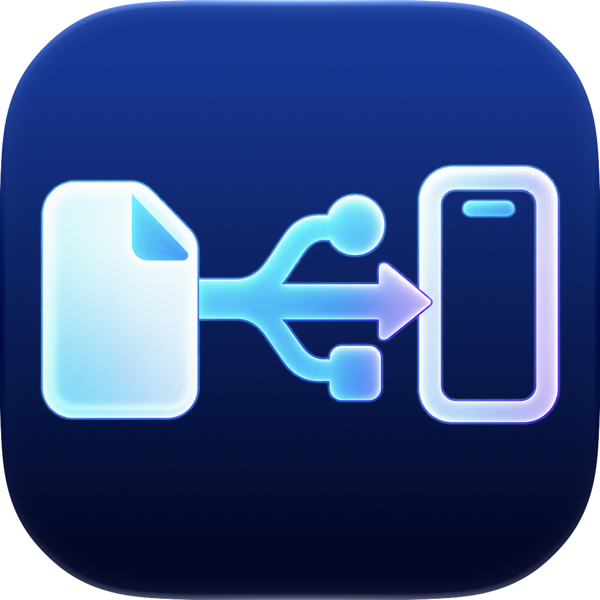

<p align="center">
  
</p>

# iFileSpan

**连接 Mac 与 iPhone / iPad 的文件通道。**

iFileSpan 是一款原生 macOS 文件管理工具，通过 USB 浏览设备允许访问的 App 目录，支持下载、上传、替换和删除文件。采用中文 SwiftUI 界面，内置 libimobiledevice 及运行依赖，开箱即可连接设备。

“Span”意为跨越、桥跨，图标以 USB 连接文件与移动设备，表达在 Mac 与 iPhone / iPad 之间传递文件的含义。

**当前版本：0.8.5 · Apple Silicon · macOS 15+**

## 功能

| 功能 | 说明 |
| --- | --- |
| 设备连接 | 通过 USB 连接、检测和切换 iPhone / iPad |
| 应用列表 | 显示 App 名称、标识符及图标，支持搜索和筛选 |
| 权限筛选 | 默认隐藏容器根目录与 Documents 均明确被拒绝的 App |
| 目录浏览 | 优先访问容器根目录，获准时可浏览 Documents、Library、tmp 等目录 |
| 文件下载 | 下载单个或多个文件、文件夹到 Mac |
| 上传与替换 | 上传本地文件或文件夹，支持备份后替换已有普通文件 |
| 文件删除 | 确认后直接删除一个或多个普通文件，删除前不备份 |
| 剪贴板 | 支持文件列表全选、复制，以及从 Finder 复制后粘贴上传 |
| 新建文件夹 | 在设备允许写入的目录创建文件夹 |
| 列表加速 | 并行检查目录权限，缓存权限结果和 App 图标 |
| 窗口恢复 | 关闭窗口后点击 Dock 图标重新打开，也可按 ⌘0 显示主窗口 |

## 系统要求

- Apple Silicon Mac（M 系列），macOS 15 或更高版本。
- 支持数据传输的 USB 线。
- iPhone / iPad 已解锁，并已选择“信任此电脑”。
- 目标 App 的目录需要设备授权访问。

发布包自带连接库，无需安装 Homebrew、额外的文件系统驱动或越狱组件。当前随附的二进制依赖仅支持 arm64；Intel Mac 需要准备对应架构的依赖后重新构建。

## 安装

1. 从 [Releases](https://github.com/LeeYZ/iFileSpan/releases/latest) 下载 [iFileSpan-v0.8.5-macOS-arm64.zip](https://github.com/LeeYZ/iFileSpan/releases/download/v0.8.5/iFileSpan-v0.8.5-macOS-arm64.zip)。
2. 解压，将 `iFileSpan.app` 拖到“应用程序”。
3. 打开 iFileSpan，用 USB 连接并解锁设备，按提示完成信任。
4. 如果正在使用旧版，请先完全退出旧版，再替换并打开新版。

当前构建使用本地临时签名，尚未经过 Apple 公证。如果系统拦截，可在“系统设置 → 隐私与安全性”中按系统提示处理。

## 使用方法

### 浏览 App 目录

选择设备后，程序会加载 App 列表，后台检查访问权限并读取图标。已有有效缓存时优先使用缓存结果；首次检查时，可访问的 App 会陆续出现，出现后即可打开。

左侧默认开启“隐藏无权限的 App”。取消后可以查看设备返回的全部 App；也可以开启“只显示开启文件共享的 App”进一步筛选。权限检查中，待确认的 App 暂不显示；连接故障不会直接判定为无权限。

选择 App 后双击文件夹进入，使用上一级按钮返回。点击“重新检测”会重新检查设备与 App 权限，忽略旧的权限缓存。

### 下载、上传与替换

- **下载**：选中一个或多个文件、文件夹，点击“下载”并选择本地保存位置。
- **上传**：进入目标目录，选择本地文件或文件夹上传；也可在 Finder 复制后回到文件列表按 ⌘V。
- **替换**：选中已有普通文件，点击“替换”并选择本地文件；程序会先备份原文件，再上传和校验新内容。
- **复制到 Finder**：在文件列表按 ⌘C，等待状态栏显示“已复制”，再到 Finder 粘贴。复制前会先下载到本地缓存。

遇到同名普通文件时，可以取消、跳过或选择备份后替换。同名文件夹不合并覆盖，符号链接和特殊文件不支持上传或导出。

### 删除文件

选中一个或多个普通文件，点击“删除文件”、使用右键菜单，或按 ⌘Delete。核对设备、App 和路径后确认“直接删除”。

**删除前不会下载或备份文件，删除后无法通过本程序恢复。** 文件夹、符号链接、特殊文件和权限受限项目不开放删除入口。批量删除遇到错误会停止后续操作；最终删除指令发出后，无法通过取消撤回。

### 关闭与重新打开窗口

点击左上角关闭按钮会关闭窗口，程序继续运行。点击 Dock 图标或使用“文件 → 显示主窗口”（⌘0）可恢复主窗口，保留本次运行中的设备和浏览状态。完全退出程序后，再次打开会重新执行启动检测。

## 快捷键

| 快捷键 | 操作 |
| --- | --- |
| ⌘A | 全选当前目录项目 |
| ⌘C | 复制选中的文件或文件夹 |
| ⌘V | 将剪贴板中的本地文件、文件夹上传到当前目录 |
| ⌘Delete | 确认后直接删除选中的普通文件 |
| ⌘⇧N | 新建文件夹 |
| ⌘↑ | 返回上一级 |
| ⌘↓ | 打开选中的单个文件夹 |
| ⌘R | 刷新当前目录 |
| ⌘⇧R | 重新检测设备与 App 权限 |
| ⌘0 | 显示主窗口 |
| Esc | 清空文件列表选择 |

使用 Command / Shift 可以多选。文件列表的选择、复制、粘贴及导航命令需要列表获得焦点；在搜索框或名称输入框中，⌘A / ⌘C / ⌘V 保持文字编辑行为。

## 访问范围

**未越狱设备上，iFileSpan 只能访问 iOS / iPadOS 允许开放的目录，不能保证读取所有 App 的完整沙盒。**

| 模式 | 行为 |
| --- | --- |
| 自动（默认） | 优先请求容器根目录；失败后尝试 Documents |
| 容器根目录 | 获准时从 `/` 浏览，包括可访问的 Documents、Library、tmp 等目录；失败时显示原因 |
| 仅 Documents | 请求目标 App 的 Documents，并将导航限制在该目录内 |
| 共享媒体目录 | 浏览设备 AFC 服务开放的共享媒体文件区 |

显示在 App 列表中不代表能够读取其私有目录；可读取也不代表可以写入或删除。某个受保护子项无法读取时，程序保留权限提示，并继续显示其他可读项目。

### 为什么看不到某些 App 或 Library、tmp？

设备可能拒绝该 App 的容器访问，或只允许 Documents。容器和 Documents 均明确被拒绝（包括双重 `InstallationLookupFailed`）的 App 默认隐藏。可取消权限筛选查看，解锁设备后重新检测。

Mac 的磁盘访问权限不能改变设备端的授权。当前版本未集成本地备份解析、越狱文件服务、Xcode 调试容器或 App 重签名功能。

## 文件替换与本地数据

替换已有普通文件时，程序先备份原内容，再分块上传到设备临时文件，回读并进行 SHA-256 校验，确认原文件未变化后提交。提交失败时尝试恢复原文件；如断线导致回滚失败，错误信息会保留恢复路径。该流程不保证断线时的原子提交。

替换前建议关闭设备上的目标 App，尤其是数据库类 App。单个数据库文件的替换不等于一致性备份；文件替换也不保留原文件的所有扩展属性、保护等级或特殊权限。

| 本地目录 | 用途 |
| --- | --- |
| `~/Library/Application Support/DeviceFiles/Backups` | 文件替换前的原文件与恢复元数据 |
| `~/Library/Caches/DeviceFiles/Clipboard` | 复制设备文件时生成的本地缓存，含实际文件内容 |
| `~/Library/Caches/DeviceFiles/Sidebar` | App 权限结果与图标缓存 |

`DeviceFiles` 是为兼容已有数据保留的目录名。替换备份会保留，点击“备份”可查看；复制缓存使用完毕后可自行清理。权限缓存有效期为 10 分钟，图标缓存为 7 天，按设备、系统版本及 App 信息隔离。

## 从源码构建

需要完整 Xcode 15 或更高版本，并将其设为当前开发工具目录。在项目根目录执行：

```sh
bash scripts/build.sh
```

构建结果位于 `dist/iFileSpan.app`。也可指定输出目录：

```sh
bash scripts/build.sh /tmp/iFileSpan-dist
```

构建脚本使用随附的 `Vendor/Frameworks`，复制并重定位动态库、签名并检查库加载，不需要下载 Swift 包。`Package.swift` 可用于在 Xcode 中浏览源码；生成完整可分发 App 请使用构建脚本。

当前附带的连接库为 arm64。Intel 构建需先替换对应架构的库；现有脚本会拒绝直接将附带的 arm64 库打入 Intel App。

### 运行测试

```sh
# 核心文件操作与故障注入测试，不连接真机
bash scripts/test.sh

# 窗口关闭与恢复测试，需要 macOS 图形登录会话
bash scripts/test-window-reopen.sh
```

### 更新图标

项目包含原生 Icon Composer 文档与已编译资源，普通构建无需重新生成图标。重新编译图标需要 Xcode 27：

```sh
bash scripts/build-icon.sh
bash scripts/build.sh
```

图标源文件位于 `AppIcon.icon`，预览位于 `Assets/iFileSpan-icon.png`，编译后的原生资源位于 `IconResources/Assets.car`。

### 项目结构

```text
Sources/
├── DeviceBridge/       # libimobiledevice C 接口桥接
├── DeviceCore/         # 设备服务、文件操作、校验与缓存
└── iFileSpan/          # SwiftUI 界面、快捷键与窗口生命周期
Tests/DeviceCoreTests/  # 核心测试
scripts/               # 构建、依赖打包与测试脚本
Vendor/                # 连接库、许可证与对应源码资料
AppIcon.icon/          # 原生图标源文件
IconResources/         # 已编译图标资源
Assets/                # 图标预览等素材
```

## 验证情况

- 63 项核心测试已通过，覆盖下载、上传、替换、校验、回滚、直接删除、剪贴板粘贴计划、权限筛选及缓存等流程。
- 已完成构建、严格签名、内置库加载、libplist 序列化、OpenSSL 运行及并行错误隔离检查。
- 已在抽样 iPhone / iPad 上验证 USB 检测、信任握手、App 列表、图标、目录读取与小文件下载；部分设备及 App 的抽样已列出 Library、tmp。这不代表任意设备或 App 均可访问。
- 窗口回归测试通过同一生命周期实现，验证三次关闭后重开、重复调用不产生多窗口、测试状态保留及“显示主窗口”入口。Dock 对应回调由测试程序调用，尚未完成真实鼠标点击 Dock 的端到端验证；最小化恢复尚未验证。
- 上传、替换、删除与失败回滚已通过内存设备测试，尚未完成真机写入、删除及完整界面交互验证。真机抽样未修改或删除用户文件。

## 0.8.5 更新

- 修复关闭主窗口后，点击 Dock 无法再次打开的问题。
- 增加“显示主窗口”菜单和 ⌘0 快捷键。
- 使用单一主窗口，重新显示时保留运行状态，避免重复启动检测。
- 延续原生图标、内置连接库和现有文件操作功能。

## 第三方组件

内置 libimobiledevice、libimobiledevice-glue、libplist、libusbmuxd 和 OpenSSL。组件版本、摘要及来源记录在 [Vendor/manifest.json](Vendor/manifest.json)，许可说明见 [THIRD_PARTY.md](THIRD_PARTY.md)。

App 的 `Contents/Resources/ThirdParty` 及源码的 `Vendor` 目录包含第三方许可证、LGPL 组件对应发布源码和构建配方。可按相应许可证修改、调试和替换动态库；替换后需重新签名库及 App。本程序未启用阻止替换动态库的强化运行时库验证。

本项目不隶属于 Apple、Homebrew 或 libimobiledevice 项目。第三方组件按各自许可证提供。
